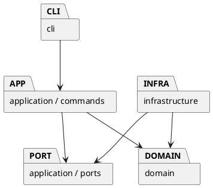

# Lab1 Phase 1：SVG 编辑器

## 架构方案

### 模块划分（初始方案）

- `src/domain`：封装图形、组合树、几何运算、唯一 id、父子关系和文档不变量。
- `src/application`：编辑用例、Command、事务式快照、撤销重做及文件端口。
- `src/infrastructure`：SVG XML 编解码和本地文件适配器。
- `src/cli`：分词、参数校验、命令注册、REPL 和文本输出。
- `src/main.ts`：依赖组装入口。

### 设计模式的选择

1. Command：每个编辑命令一个类；通过统一历史管理器执行、撤销和重做。
2. Composite：`Shape` 是叶子与 `Group` 的共同抽象，组递归执行几何操作。
3. Memento：编辑前克隆文档，编辑在副本上完成；成功才替换当前文档并记入历史，失败保持原状态。
4. 工厂与适配器：图形构造集中到 `ShapeFactory`；应用通过文件端口读写，不直接依赖 Node 文件系统。

仅两处按名字分派：CLI 命令注册表、图形工厂类型注册表。它们是后续插件化阶段的待重构点；本阶段保持显式注册。

### 依赖方向规则

`domain` 不依赖其他层或 Node IO；`application` 只依赖 domain 和端口；`infrastructure` 实现端口并依赖 domain；`cli` 只消费应用层和自身解析器；入口可以组装所有层。测试可以跨层验收。外层依赖内层，避免领域模型绑定终端或 XML 库。

### 变化点假设

- 新增图形：保留抽象 Shape 和集中工厂，后续再增加 ShapeProvider 插槽，本阶段不实现 box。
- GUI/agent 输入：CLI 只负责解析，编辑命令可由其他前端直接调用。
- 新存储：通过文件端口替换本地存储。
- 大文档撤销性能：先用完整快照保证原子性；本阶段不做复杂的增量补丁，代价是历史空间随文档大小增长。

## 过程记录

- 2026-10-29：读取原始说明，确认本阶段仅六种内置图形；box 为后续目标，不能把示例 B 当成本阶段需求。
- 2026-10-29：初始目录只有作业说明，尚无 Git 仓库；先记录架构再实现，使用实际分阶段提交。
- 2026-10-29：选用事务式快照处理跨父节点 group、非法循环和导入失败，避免命令部分失败后污染状态。

## 一致性自查

待实现后据实际代码与依赖检查补全。

## 质量保证手段

计划通过领域单元测试、应用层命令集成测试、真实 CLI 脚本回放和 SVG 写出读回检查覆盖功能与错误原子性。最终执行结果将在完成后补充。
