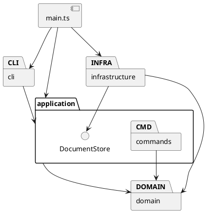

# Lab1 项目说明

这个作业实现了一个命令行 SVG 编辑器，支持题目要求的六种图形和编辑命令。运行方法和示例放在[根目录 README](../README.md)，这里主要说明代码怎么组织，以及实现过程中做过的修改。

## 架构方案

### 模块划分

代码分成四层，另外由 `main.ts` 把它们接起来。

| 目录 | 负责的内容 |
|---|---|
| `src/domain` | 图形、分组、画布，以及移动、缩放和父子关系等操作 |
| `src/application` | 编辑命令、撤销重做、当前文档和文件读写接口 |
| `src/infrastructure` | 读写本地文件，解析和生成 SVG |
| `src/cli` | 拆分输入参数、分发命令、显示结果 |

这样划分主要是想把“怎么输入命令”和“怎么修改图形”分开。例如，以后换成鼠标操作，图形和编辑命令这两部分仍然可以继续使用。



### 设计模式的选择

**Command** 是这次作业要求使用的模式。`commands/` 下每个编辑命令都有自己的类，比如 `MoveCommand`、`GroupCommand`。CLI 解析参数后创建命令对象，再交给 `Editor` 执行，不在解析输入的地方直接修改图形。

撤销重做由 `CommandHistory` 管理，并配合 **Memento（备忘录）** 保存文档快照。执行命令前先复制文档，命令在副本上操作。成功后保存前后两个版本；失败则丢弃副本。这样，一条 group 命令即使涉及多个父节点，也能一次撤销，出错时不会只改了一半。

这里选择保存整个文档，是因为它比较容易实现和检查。缺点是每条编辑都要复制图形树，文档很大时会占用较多内存。对于这个阶段的小型示例，先接受这个开销。

图形部分用了 **Composite（组合）**。`Rect`、`Circle` 等图形和 `Group` 都继承 `Shape`，对外提供相同的 move、scale、set 等操作。分组的 move、scale 会继续调用子图形的方法，所以嵌套分组也能整体移动和缩放。

此外，`ShapeFactory` 集中创建图形；`LocalDocumentStore` 通过 `DocumentStore` 接口提供文件读写。前者方便管理六种图形的参数，后者让编辑逻辑不用直接调用文件系统。

按名字查找实现的地方保留了两处：`CommandDispatcher` 的命令表、`ShapeFactory` 的图形类型表。这两处暂时还是写在代码里的，后续做插件化时需要改成注册接口。

### 依赖方向规则

- `domain` 不引用其他层，也不读取文件或终端输入。
- `application` 可以引用 `domain`，文件操作只通过自己定义的 `DocumentStore` 接口。
- `infrastructure` 实现文件接口，可以引用 `application` 的端口和 `domain`。
- `cli` 只引用 `application` 和 CLI 自己的解析类。
- `main.ts` 负责组装，可以引用以上各层。

这样做是为了让图形操作不依赖 Node 文件接口、XML 解析库或某种输入方式。测试文件需要直接检查各层，可以跨层引用。

### 变化点假设

后面比较可能变化的是图形种类和输入方式。新增图形可以继承 `Shape`，再补充工厂注册；本阶段没有实现题目后续阶段的 box。换成 GUI 或 agent 输入时，可以复用已有的 Command。

文件保存方式也可能变化，所以保留了 `DocumentStore` 接口。至于大文档的撤销性能，目前没有做增量记录，等到有实际需要时再把完整快照换成变化记录。

## 过程记录

实现时使用了 Codex 辅助搭建类结构、编写命令和测试。下面几处修改对最终代码影响比较大。

### 撤销时保存什么

分组涉及从不同位置取出图形，再放进新的容器。如果每个命令分别写一套反向操作，容易漏掉原来的父节点或顺序。因此这里采用文档快照：undo 恢复编辑前的版本，redo 恢复编辑后的版本。测试中也检查了分组和删除容器都只占一个撤销步骤。

### CLI 对图形类的依赖

早期 CLI 为了解析数字，直接引用了 `Shape` 的数值解析方法。这样虽然能运行，但不符合前面约定的依赖方向。后来加了应用层的 `InputNumber`，让 CLI 通过它解析数字，并加了一项源码依赖检查，防止后面又引入类似的引用。

### 一个测试断言的问题

首轮测试有一项失败：测试想检查 `g#a` 是否排在 `g#b` 前面，但字符串查找把 `g#b` 匹配到了 `g#before` 里面。后来改为比较完整子树的输出。这次修改只改了测试，分组的实现没有跟着改。

### 读取带 transform 的 SVG

一开始把 SVG 的缩放换算到坐标时，只处理了位置和尺寸，漏了文字大小和线宽。后来补上了这部分，也加了嵌套变换和继承样式的测试。导入时的变换处理，与 CLI 的 scale 是分开的：CLI scale 仍然只缩放题目规定的几何属性。

另外，XML 库的 `getAttribute` 可能返回 null，编译检查后补上了处理；启动方式改为 `node --import tsx`，解决了受限环境下 tsx 启动时的管道权限问题。

### 几处题目没有展开的细节

分组内的顺序按原文档的顺序保留，不按命令参数重新排序。同一个父节点下分组时，新组放在最早被选中图形的位置。跨父节点分组时，新组放到画布根下；如果选中了根级图形，就放在其中最早的位置，否则放在最后。undo 会恢复各图形原来的位置。

按照题目要求，根级 g 不能 ungroup，嵌套 g 才能解散。对 g 设置 fill 等属性时，使用 SVG 自带的样式继承。

init、read、save 和修改画布尺寸成功后，会清空撤销历史。查询画布尺寸和显示类命令保留历史，失败的命令也不会清空历史。保存成功后记住这次的文件路径，下一次 save 可以省略路径。

## 一致性自查

实际目录与前面的划分一致。每个类单独放在同名文件中；图形类负责自己的几何操作，Group 负责递归处理子节点。后来增加的 `InputNumber` 和 `SvgTransform` 仍放在各自所属的层内，没有新增一层。

依赖方向通过 `tests/architecture.test.ts` 检查。它会扫描源码的 import，检查各层能引用哪些目录，也会检查类名与文件名是否一致、是否出现 switch。抽样看，`Rect` 只引用 `Shape`，`MoveCommand` 引用 `Command` 和 `SvgDocument`，`Editor` 通过 `DocumentStore` 读写文件，符合方案。

目前没有发现违反这些依赖规则的引用。命令表和图形类型表仍是后续插件阶段需要修改的地方。

## 质量保证手段

在 Node.js 20.20.2 下运行了下面的检查，类型检查和编译通过，39 项测试全部通过。

```sh
npm run check
npm run build
npm run cli < examples/flowchart.commands
```

测试大致分为四部分：

| 测试文件 | 主要检查内容 |
|---|---|
| `editor.test.ts` | 六种图形和各条命令、分组顺序、循环嵌套、撤销重做、错误后文档是否保持原样 |
| `svg.test.ts` | 缺 id 的文件、文字转义、保存后读回、嵌套变换、错误 XML 和文件写入失败 |
| `cli.test.ts` | 启动 CLI 子进程，连续输入命令，检查 read/save 的执行顺序和最后生成的 SVG |
| `architecture.test.ts` | 模块引用关系、一类一文件、没有 switch 分派 |

另外从 GitHub 重新克隆了一份，执行 `npm ci` 后再次检查，并运行编译后的 CLI，生成的流程图与仓库中的示例一致。交互终端中也检查了提示符、read 和 show。SVG 做过解析和保存后读回检查，尚未做浏览器中的视觉检查。

### 目前的限制

编辑器支持的是题目要求的 SVG 子集。导入时支持六种内置元素、常用文字样式、平移和正数等比缩放；不支持 path、tspan、CSS style、旋转、斜切、非等比缩放，以及百分比等相对单位。viewBox 需要从原点开始，并与画布尺寸一致。遇到不支持的内容会报错。

保存后不会保留原文件的排版和注释。撤销使用完整快照，大文档的时间和内存开销也还需要优化。
