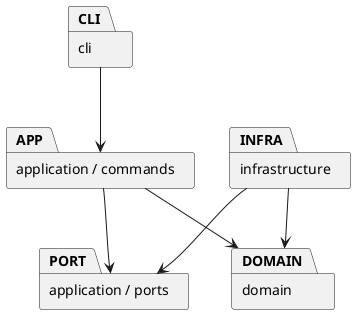

# Lab1 Phase 1：SVG 编辑器

## 架构方案

### 模块划分

- `src/domain`：封装图形、组合树、几何运算、唯一 id、父子关系和文档不变量。
- `src/application`：编辑用例、Command、事务式快照、撤销重做及文件端口。
- `src/infrastructure`：SVG XML 编解码和本地文件适配器。
- `src/cli`：分词、参数校验、命令注册、REPL 和文本输出。
- `src/main.ts`：依赖组装入口。



### 设计模式的选择

1. Command：每个编辑命令一个类；通过统一历史管理器执行、撤销和重做。
2. Composite：`Shape` 是叶子与 `Group` 的共同抽象，组递归执行几何操作。
3. Memento：编辑前克隆文档，编辑在副本上完成；成功才替换当前文档并记入历史，失败保持原状态。
4. 工厂与适配器：图形构造集中到 `ShapeFactory`；应用通过文件端口读写，不直接依赖 Node 文件系统。

仅两处按名字分派：CLI 命令注册表、图形工厂类型注册表。它们是后续插件化阶段的待重构点；本阶段保持显式注册。

### 依赖方向规则

`domain` 不依赖其他层或 Node IO；`application` 只依赖 domain 和端口；`infrastructure` 实现端口并依赖 domain；`cli` 只消费应用层和自身解析器；入口可以组装所有层。测试可以跨层验收。外层依赖内层，避免领域模型绑定终端或 XML 库。

| 实际文件/目录 | 职责和边界 |
|---|---|
| `domain/Shape.ts`、六个图形子类 | 私有字段、属性白名单、几何验证与多态运算；每个类独立文件 |
| `domain/Group.ts` | Composite：持有子节点，递归 move/scale/clone |
| `domain/SvgDocument.ts` | 聚合根：画布、唯一 id、查找、分组、循环检查、同级顺序 |
| `domain/ShapeFactory.ts` | 六种图形构造与 create 参数 schema，唯一的图形类型分派 |
| `application/commands/` | 十个具体编辑 Command，加抽象 Command；参数由对象封装 |
| `application/CommandHistory.ts`、`HistoryEntry.ts` | Command 执行、Memento 快照、undo/redo、IO 屏障 |
| `application/Editor.ts` | 当前文档、关联路径与用例协调；不向前端暴露可修改的文档引用 |
| `application/DocumentFormatter.ts`、`InputNumber.ts` | 展示模型与数值输入入口，避免 CLI 反向穿透领域层 |
| `application/ports/DocumentStore.ts` | 文件端口接口，应用层不认识 fs 或 XML 解析器 |
| `infrastructure/LocalDocumentStore.ts` | UTF-8 本地文件、同目录临时文件后 rename、失败清理 |
| `infrastructure/SvgCodec.ts`、`SvgTransform.ts` | XML 编解码、补 id、SVG 变换规范化；不包含 CLI 命令 |
| `cli/Tokenizer.ts`、`Arguments.ts` | 引号、转义、注释、参数个数与尾部 in 子句 |
| `cli/CommandDispatcher.ts`、`Repl.ts` | 唯一的命令名分派、逐行串行 await、终端输入输出 |
| `main.ts` | 唯一组装入口，注入 LocalDocumentStore |

### 变化点假设

- 新增图形：保留抽象 Shape 和集中工厂，后续再增加 ShapeProvider 插槽，本阶段不实现 box。
- GUI/agent 输入：CLI 只负责解析，编辑命令可由其他前端直接调用。
- 新存储：通过文件端口替换本地存储。
- 大文档撤销性能：先用完整快照保证原子性；本阶段不做复杂的增量补丁，代价是历史空间随文档大小增长。

## 过程记录

- 2026-10-29：读取原始说明，确认本阶段仅六种内置图形；box 为后续目标，不能把示例 B 当成本阶段需求。
- 2026-10-29：初始目录只有作业说明，尚无 Git 仓库；先记录架构再实现，使用实际分阶段提交。
- 2026-10-29：选用事务式快照处理跨父节点 group、非法循环和导入失败，避免命令部分失败后污染状态。
- 2026-10-29：实现后检查到 CLI 直接导入 Shape 的数字解析方法，违反初始依赖规则；新增应用层 InputNumber 入口，并用自动依赖检查防止回归。
- 2026-10-29：首次严格编译暴露 XML 库 getAttribute 的可空类型，补齐缺省值处理。tsx 独立命令在受限环境创建 IPC 管道失败，改用 Node 的 `--import tsx` 入口，验证真实子进程启动成功。
- 2026-10-29：首轮功能测试 35/36 通过；唯一失败是测试把 `g#b` 匹配进 `g#before`，改成完整子树精确断言后通过，领域代码无须为此修改。
- 2026-10-29：检查外部 SVG transform 时发现仅乘几何坐标会漏掉字形大小和线宽，补充继承样式缩放与专门回归测试。CLI 的 scale 仍严格只改题目规定的几何属性。
- 2026-10-29：加入真实 CLI 子进程回放、文件权限失败和架构检查，最终 39 项测试通过；交互终端确认启动横幅、`svg>` 提示符、读取示例及 show 输出正常。

### 语义补充与修订记录

题目未明确 group 跨父节点时新组应放哪里，采用以下可重复规则：同父节点时在最早选中节点的位置插入新组；跨父节点时新组归根，在根级选中节点的最早槽位插入，若没有根级选中节点则追加。组内顺序始终采用操作前的文档先序顺序，不受参数排列影响。原有坐标不变。undo 一次恢复所有来源父节点与位置。

题目要求根级容器禁止 ungroup，本实现遵循该规则；只能解散嵌套 g。普通 g 的 set 修改组属性，使用 SVG 原生样式继承，不把 fill 写入每个子节点；它与后续 box 的领域属性传播有不同的职责。

显示类与 canvas 查询保留历史；init/read/save 成功、canvas 修改成功才清空历史并锁定 undo/redo。任何失败不清空历史，不更新关联路径；下一条成功编辑创建新的历史。save 成功后记住保存路径，后续省略路径保存到最近一次成功读写的文件。

无方案目录变更；新增 InputNumber、SvgTransform 是既有模块内部的职责细化。两处注册表仍是后续插件阶段的待重构项；本阶段没有提前实现 box 或动态插件。

## 一致性自查

1. **模块划分**：实际目录与方案一致。所有生产类均一类一文件，文件名与类名一致；图形为行为丰富的类层次，私有字段保存状态。输入只生成 Command，几何/层级操作由领域模型执行，没有到处 switch(tag)。文件端口是接口，Token 与变换继承参数是不可变类型值，不承担领域行为。
2. **依赖方向**：`tests/architecture.test.ts` 遍历生产源码的 import，检查各层允许依赖和内层禁止外部库；同时检查一类一文件及禁止 switch。抽样：`Rect → Shape`、`MoveCommand → Command/SvgDocument`、`Editor → DocumentStore`、`LocalDocumentStore → DocumentStore/SvgCodec`、`CommandDispatcher → Editor/具体 Command/InputNumber`，均符合规则。该静态检查随 `npm test` 执行，最终通过。

## 质量保证手段

2026-10-29 在本机 Node.js 20.20.2 实际执行：

```sh
npm run check
npm run build
npm run cli < examples/flowchart.commands
```

- 严格 TypeScript 类型检查、构建通过；自动化测试 **39/39 通过**。
- `tests/editor.test.ts`：覆盖全部命令与六种类型、in 子句、id 冲突、非法父节点/循环、分组顺序、递归删除、同级 front/back、文本引号、参数错误、负尺寸、数值溢出和事务原子性。
- `tests/svg.test.ts`：题目 other.svg 七元素导入、预留后置显式 id 后再自动补 id、Unicode/XML 转义、保存读回、嵌套变换和继承样式、错误 XML/未知图形/不支持属性拒绝；真实磁盘读写及只读失败后原文件保留、临时文件清理。
- `tests/cli.test.ts`：启动真实 CLI 子进程，一次管道输入含 read/save/编辑/错误恢复，核对输出和最终磁盘 SVG，确认异步 IO 没有与下一条命令竞态，EOF 正常退出。
- `tests/architecture.test.ts`：自动检查依赖方向、一类一文件及不存在 switch。
- `examples/flowchart.commands` 实际生成 `examples/flowchart.svg`（8 元素），完整输出保存在 `examples/flowchart.transcript.txt`；另用交互 TTY 核对提示符和读取后的属性。SVG 已通过 XML 解析和保存读回检查；未将浏览器视觉渲染计为已完成的验证。

### 范围与代价

- 支持 rect/circle/ellipse/line/text/g；其他元素明确报错，box 按要求返回 unknown shape type。
- SVG 导入支持本作业的几何和样式子集、常用文本展示属性、translate/正数等比 scale。变换会规范化到几何与必要的字形/线宽属性。旋转、斜切、非等比 scale、path、tspan、CSS style、百分比/相对单位、非零原点或不同尺寸的 viewBox 不在本阶段范围，遇到后报错而不部分导入。
- 保存输出规范化的 SVG，不保留原 XML 排版、注释或 processing instruction；缺失 id 会补齐并警告。显示文本可能与题目示例的空格排版不同，包含同等的关键属性。
- 快照历史时间/空间约为每条编辑 O(N)，适合本阶段小型图形；超大文档的补丁历史和 id 索引属于未来优化。
- 未添加额外人工使用结果；自动测试通过不等同于覆盖所有第三方 SVG。

## 使用与提交

仓库：https://github.com/Wuyh11/lab1_Phase1_SVG

最终标签：`final`。根目录 `README.md` 可独立上传至课程平台，其中包含仓库地址；本文件满足题目要求的 `doc/README.md` 文档位置。仓库已公开，评阅者可直接访问。

```sh
npm ci
npm run cli
```

输入 help 查看全部语法，Ctrl+D 结束。构建后可 `npm start`。项目依赖使用 lockfile 固定，并通过项目级 `.npmrc` 选择官方 npm 源，不改动本机全局 npm 配置。
